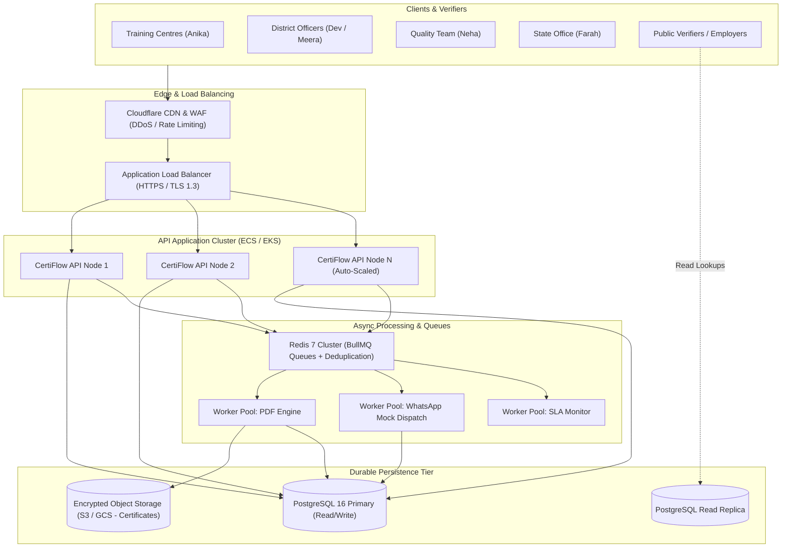

# CertiFlow — Production Deployment & Scale Architecture

> **Pragati Skills Mission**  
> Operational capacity: 100,000 registered candidates, 10,000 daily active users (DAU), with peak results load of 500 batches/hour (~30,000 PDFs and WhatsApp messages/hour).

---

## 1. Architecture Diagram

---

## 2. Peak Load Capacity & Sizing Analysis

### Stated Peak Scenario
- **Volume**: 500 batches approved in 1 peak hour.
- **Batch Size**: Average 60 candidates per batch.
- **Generation Demand**: $500 \times 60 = 30,000\text{ PDFs/hour}$ ($\approx 8.33\text{ PDFs/second}$).
- **Notification Demand**: $30,000\text{ WhatsApp deliveries/hour}$ ($\approx 8.33\text{ messages/second}$).
- **Public Verification Queries**: Bursts of up to $2,000\text{ queries/minute}$ immediately after result announcements.

### Worker Pool Throughput Calculation
1. **PDF Generation**:
   - Single PDF compilation + QR embedding requires $\approx 35\text{ms}$ CPU time.
   - 1 CPU core processes $\approx 28\text{ PDFs/second}$.
   - To sustain 30,000 PDFs/hour with peak 4x spikes ($35\text{ PDFs/sec}$), a cluster of **4 worker instances (2 vCPU each)** provides ample headroom without backlog growth.
2. **Mock WhatsApp Dispatch**:
   - Asynchronous HTTP dispatch via BullMQ with concurrency set to 50 concurrent jobs per worker.
   - Throughput easily exceeds $150\text{ messages/sec}$.

---

## 3. Failure Modes & Resilience Strategies

| Failure Domain | Risk | Mitigation Architecture |
| :--- | :--- | :--- |
| **API Crash during Approval** | Batch marked APPROVED, but queue job lost. | **Transactional Outbox**: Approval updates PostgreSQL state and inserts outbox record in the same atomic transaction. Outbox poller ensures at-least-once queue delivery. |
| **Worker Process Crash** | Job crashes mid-PDF generation. | **BullMQ Stalled Job Recovery**: Locks are auto-renewed. If heartbeat lapses, job is re-queued to another worker instance. |
| **Redis Outage** | Queue state unavailable. | Multi-AZ Redis replication with automated failover (< 15 second election). In-flight jobs are persisted on disk via AOF (`appendonly yes`). |
| **WhatsApp Provider Failure** | Transient network error / timeout (simulated 15% error, 5% timeout). | **Bounded Exponential Backoff**: Retries at $2^a \times 500\text{ms}$ up to 3 bounded attempts. Idempotency keys (`candidateId:batchId`) prevent duplicate message delivery. |
| **Database Failover** | Primary database node hardware failure. | AWS Aurora / GCP Cloud SQL Multi-AZ failover with hot standby replica. Switchover takes $< 30\text{ seconds}$. |

---

## 4. Security, Access Control & Privacy

1. **Certificate PDF Storage**:
   - Certificates stored in private cloud object storage (`s3://pragati-certificates-prod/`).
   - S3 bucket policy blocks public read access (`BlockPublicAcls = true`).
   - Downloads require time-limited presigned URLs (15-minute TTL) issued strictly to authorized callers (State Office, District Officer, owning Training Centre, or candidate download token).
2. **Zero-PII Public Verifications**:
   - Public endpoint queries never return candidate phone numbers or Aadhaar/national ID numbers.
   - QR code embeds a 128-bit cryptographically random verification token (`cf_vtok_...`), not sequential candidate IDs.
3. **Audit History Immutability**:
   - All state transitions record actor ID, name, role, decision, reason, timestamp, and revision cycle.
   - Database trigger forbids `UPDATE` or `DELETE` on the `audit_logs` table.

---

## 5. Estimated Monthly Hosting Budget (Cloud Infrastructure)

| Component | Specification | Estimated Cost (USD/month) |
| :--- | :--- | :--- |
| **Database** | AWS RDS PostgreSQL 16 (`db.t4g.medium`, Multi-AZ, 100 GB SSD) | $110 |
| **Cache & Queue** | AWS ElastiCache Redis 7 (`cache.t4g.small`, Multi-AZ) | $55 |
| **API Cluster** | AWS ECS Fargate (2 tasks $\times$ 1 vCPU, 2 GB RAM) | $60 |
| **Worker Cluster** | AWS ECS Fargate (2 tasks $\times$ 1 vCPU, 2 GB RAM, auto-scale up to 6 on peak) | $75 |
| **Object Storage** | AWS S3 Standard (30,000 PDFs/mo $\approx$ 1.5 GB/mo + retrieval) | $5 |
| **Networking & CDN** | Cloudflare Pro + AWS ALB data transfer | $45 |
| **Observability** | CloudWatch Logs + Sentry Error Tracking | $30 |
| **Total** | **Production High-Availability Environment** | **~$380 / month** |

---

## 6. Service Level Agreements (SLAs) & Monitoring

- **Batch Processing SLA**: Batches pending review $> 48\text{ hours}$ trigger automated escalation alerts.
- **Certificate Verification Latency**: $P_{99} < 100\text{ms}$ for unauthenticated public lookups.
- **Issuance Pipeline Latency**: $P_{95} < 5\text{ seconds}$ from State final approval to PDF generation.
- **Availability Target**: 99.9% uptime during operational testing windows.
